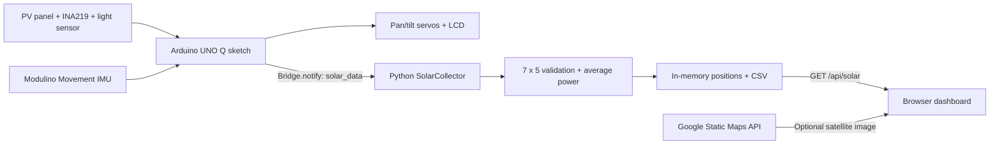

# 😀 HACKTURIN

# photoRover

**A mobile photovoltaic surveying prototype built for HACKTURIN 2026.**

photoRover explores the solar-energy potential of different locations and panel orientations. A small photovoltaic panel mounted on a two-axis servo mechanism is carried on a rover/cart. At each stop, the system scans **35 orientations**, measures electrical power, estimates the cart's relative position, and sends the results to an interactive browser dashboard.

The repository retains some original **HACKTURIN** and **SolarScout** names in application configuration and UI. **photoRover** is the project name used in this documentation.

> **Prototype scope:** photoRover measures power produced by its own panel and electrical setup. It is not a calibrated solar-irradiance instrument or a GPS-accurate site survey.

## What it does

- **Two-axis solar scan:** servo-driven pan from **0° to 180°** and tilt from **30° to 150°**, both in 30° steps (7 × 5 = **35 samples**).
- **Electrical measurements:** an **INA219** measures bus voltage (V) and current (mA); the sketch computes power in milliwatts (`V × mA = mW`).
- **Light sensing:** an analog light reading on **A0** is recorded for each orientation on the Arduino.
- **Orientation optimization:** the firmware identifies the pan/tilt combination with the highest measured panel power and returns the servos to that position after a scan.
- **Relative rover tracking:** a **Modulino Movement** sensor provides acceleration-based X/Y estimates and orientation information.
- **Local feedback:** a **16×2 Grove RGB LCD** displays the most recent position and peak scan power; the Serial Monitor prints measurement tables and a CSV-style map report.
- **Live browser dashboard:** Python receives a 7×5 power matrix over Arduino Bridge and serves a colored trajectory, numbered points, a 35-cell heatmap, and current statistics.
- **Optional satellite imagery:** a Google Maps Static API background is automatically framed around the relative route when a map origin and valid API key are available.

## System overview



### Important distinction: peak power vs. average power

The Arduino finds the **maximum** of the 35 panel-orientation readings to choose its best servo position and update the LCD. The Python collector computes the **average** of the 35 readings and stores it as `power_mw` for each trajectory point. The dashboard's “Maximum Power” card is the maximum **recorded point average**, not necessarily the Arduino's best individual orientation reading.

## Hardware and software

| Component | Purpose |
| --- | --- |
| Arduino UNO Q | Runs the Arduino sketch and Arduino App Lab / Python components |
| Photovoltaic panel | Electrical source under test |
| INA219 (`0x40`, I²C) | Panel voltage and current measurements |
| Analog light sensor (`A0`) | Light-level comparison at each scan angle |
| Modulino Movement | Motion/stability detection and IMU-based position estimation |
| Two servos (`D9`, `D10`) | Pan and tilt actuation |
| Grove RGB LCD (16×2, I²C) | Last scan position and peak measured power |
| Arduino App Lab + RouterBridge | MCU-to-Python communication and WebUI hosting |
| Browser + optional Google Maps Static API | Live power visualization over an optional satellite background |

> **Electrical note:** The source code identifies control/signal pins, not a verified full wiring schematic. Supply servos from a suitable regulated power source, with appropriate common grounding; do not assume an Arduino signal pin powers a servo.

## Repository structure

```text
.
├── README.md                 # Project overview (this file)
├── app.yaml                  # Arduino App Lab configuration (currently named HACKTURIN)
├── .gitignore
├── assets/
│   ├── index.html            # Dashboard layout and styling
│   └── map.js                # Live polling, trajectory, heatmap, satellite overlay
├── python/
│   ├── README.md             # Python subsystem documentation
│   ├── main.py               # Application entry point
│   ├── app.py                # Bridge and WebUI registration
│   ├── collector.py          # Collect, validate, retain, export
│   ├── processing.py         # 7x5 power-matrix validation and averaging
│   ├── generate_test_data.py # Legacy simulated-data generator (see note)
│   ├── test_data.json        # Legacy test fixture (see note)
│   ├── requirements.txt
│   └── solar_data.csv        # Historical sample file in the archive
└── sketch/
    ├── README.md             # Firmware and hardware documentation
    ├── sketch.ino            # Sensor, IMU, servo and Bridge firmware
    └── sketch.yaml           # Arduino library/platform profile
```

The browser also loads `assets/maps-config.js`, but this file is **not included in the repository** and is excluded by `.gitignore`.

## Getting started

1. **Open the project in Arduino App Lab** on the UNO Q. The checked-in `app.yaml` registers the `arduino:web_ui` brick. Follow your installed App Lab version's normal project import/open workflow.
2. **Connect the hardware** according to your build: INA219 on I²C, analog light input on A0, pan and tilt servo control on D9 and D10, Modulino Movement, and the 16×2 LCD. Check servo power independently.
3. **Check sketch libraries** in [`sketch/sketch.yaml`](sketch/sketch.yaml), including Arduino Modulino, Servo, Adafruit INA219, and Grove LCD RGB Backlight. Build and upload `sketch/sketch.ino` through the App Lab workflow.
4. **Configure the optional satellite map.** Create the ignored file `assets/maps-config.js`:

   ```javascript
   window.SOLARSCOUT_GOOGLE_MAPS_KEY = "YOUR_RESTRICTED_MAPS_STATIC_API_KEY";
   ```

   Enable **Maps Static API**, configure Google Cloud billing, and restrict the key appropriately. Without a working key, sensor data and the trajectory can still display without satellite imagery.
5. **Start the App Lab application.** `python/main.py` launches the registered Python backend. Open the WebUI address printed in the application logs (normally port `7000` on the appropriate host).
6. **Perform a scan.** Keep the cart stationary during the 7×5 sweep. After a full scan, the Arduino sends one JSON measurement. Move the cart, stop again, and scan another position to build a route.
7. **Observe the dashboard.** The browser polls `GET /api/solar` about once a second. Actual **new** data arrives only after the Arduino completes another scan.

See [Python documentation](python/README.md) and [firmware documentation](sketch/README.md) for details.

## Live data contract

The Arduino emits `Bridge.notify("solar_data", json)`, where `json` has this structure:

```json
{
  "x": 1.25,
  "y": -0.40,
  "power": [
    [2, 4, 6, 8, 10],
    [3, 5, 7, 9, 11],
    [4, 6, 8, 10, 12],
    [5, 7, 9, 11, 13],
    [6, 8, 10, 12, 14],
    [7, 9, 11, 13, 15],
    [8, 10, 12, 14, 16]
  ]
}
```

- `x`, `y`: **relative IMU-estimated position**, treated as meters by the visualizer.
- `power`: 7 rows × 5 columns of **milliwatts**, with the first index corresponding to pan and the second to tilt.
- On the web side, the matrix is returned under `power_matrix`; route points contain `power_mw` (the average of all 35 readings).

The frontend color scale is currently **0 mW = red** and **20 mW or more = green**. See `RED_POWER_MW` and `GREEN_POWER_MW` in `assets/map.js`.

## Accuracy, current limitations, and known issues

- **Position is estimated, not measured with GPS.** The sketch integrates accelerometer readings without a full orientation-aware inertial navigation filter; noise, gravitational tilt, and scan delays cause drift. Satellite coordinates additionally assume X points east and Y points north, which the sketch does **not** establish.
- **Map origin is not rover GPS.** The frontend currently has `MANUAL_LOCATION = null`, attempts browser geolocation (subject to secure-context permissions), and then uses public-IP location. Neither is guaranteed to identify the rover's position.
- **Location-fallback bug in this commit:** `assets/map.js` references `FALLBACK_LOCATION` even though its declaration is commented out. If browser and IP geolocation both fail, an error can prevent the satellite background from initializing. Define a fallback or return `null` and handle it before reading `mapOrigin.lat`.
- **Simulated data is outdated.** `python/generate_test_data.py` and `python/test_data.json` still use 10×10 voltage/current matrices, while the active collector expects a 7×5 `power` matrix. `TEST_MODE = False` in the checked-in `python/app.py`, so live measurements are the intended path.
- **Python callback is registered twice:** `Bridge.provide("solar_data", collector.receive)` appears before and within the `else` branch of `app.py`; remove the duplicate when maintaining the source.
- **CSV is temporary.** The runtime collector writes `/tmp/solar_data.csv`; its history is not automatically restored at app startup. The archived `python/solar_data.csv` is a historical sample and is not the current output path.
- **Scan cadence:** a complete sweep, stability checks, and servo movements take substantially longer than the one-second WebUI polling interval.
- **Memory limits:** Python retains up to 1,500 route points per running process; Arduino's serial-export buffer retains up to 50 map points.

## Project background

Developed as a **HACKTURIN 2026** hackathon prototype under the repository name **Photo-Rover-HackTurin2026-Scappati-da-Milano-**. Its goal is to make local solar-energy exploration tangible: measure, move, rescan, and compare.

## Documentation

- [Python backend and API](python/README.md)
- [Arduino firmware, hardware, and scanning](sketch/README.md)


