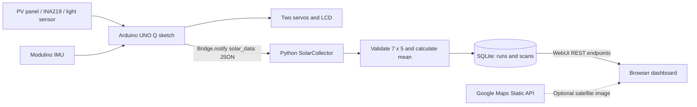

# photoRover ☀️

**Mobile photovoltaic mapping prototype | HACKTURIN 2026 | Scappati da Milano**

photoRover surveys how the electrical output of a small photovoltaic panel varies with **location** and **panel orientation**. An Arduino UNO Q controls a pan/tilt platform on a moving cart. At each stop it scans 35 directions, measures the panel's output, and sends the results to a Python service. A browser dashboard plots the route and lets you review, name, and manage **persisted survey runs** using SQLite.

> **Project naming:** The repository/project is called **photoRover**. The existing App Lab application is named `HACKTURIN` (`app.yaml`), and its browser interface says **SolarScout**. These are historical labels in the current code, not different applications.
>
> **Prototype limitation:** Panel output in mW is *not* calibrated solar irradiance; motion-based positions are estimates rather than GPS tracks. See [Accuracy and limitations](#accuracy-and-limitations).

## Features

- **Two-axis measurement:** seven physical servo pan commands (`0, 30, …, 180°`) and five tilt commands (`30, 60, …, 150°`), for **7 × 5 = 35** readings per completed scan.
- **Electrical and light sensing:** INA219 reads voltage in V and current in mA; the firmware computes `power_mW = voltage_V × current_mA`. A separate analog light sensor on `A0` is sampled locally.
- **Automatic orientation selection:** the sketch identifies the highest-power orientation and returns the two servos to it after each scan.
- **Movement/stability detection:** a Modulino Movement sensor is used to wait for the cart to stop and estimate relative X/Y position by integrating acceleration.
- **Local feedback:** a Grove 16×2 RGB LCD reports the latest estimated X/Y and the scan's best power; Serial output includes per-angle measurements and CSV-like route summaries.
- **Live dashboard:** colored route, live statistics, and a **7-column pan × 5-row tilt heatmap** with a non-color-changing outline around the maximum cell.
- **Persistent history:** SQLite groups measurements into runs. The UI can start a new run, rename or delete a run, set its starting GPS location, and inspect individual historical scans.
- **Optional satellite backdrop:** Google Maps Static API imagery with automatic framing when a key is provided.

## Architecture



**Every complete sweep sends one scan**, not 35 API requests. The sketch transmits `x`, `y` and the 7×5 `power` matrix. Python timestamps, validates and stores the scan in SQLite, then exposes the run via the WebUI API. The browser polls the backend about once per second. It can render stored scans even after the application has restarted.

## Repository layout

```text
.
├── README.md                   # You are here
├── app.yaml                    # App Lab configuration (HACKTURIN + WebUI brick)
├── .gitignore                  # Excludes cache, data/, secrets/config
├── sketch/
│   ├── sketch.ino              # IMU, scanning, INA219, servos, LCD, bridge
│   ├── sketch.yaml             # Zephyr platform + Arduino libraries
│   └── readme.md               # Firmware and hardware guide
├── python/
│   ├── main.py                 # Python entry point
│   ├── app.py                  # App Lab app, bridge and HTTP API
│   ├── collector.py            # Bridge receiver + current active run
│   ├── processing.py           # Matrix validation and 35-value mean
│   ├── db.py                   # SQLite schema, CRUD and scan persistence
│   ├── requirements.txt        # Legacy general-purpose Python dependencies
│   ├── generate_test_data.py   # Outdated 10x10 fixture generator (see note)
│   ├── test_data.json          # Outdated fixture (not compatible with collector)
│   ├── solar_data.csv          # Bundled historical sample, not live storage
│   └── readme.md               # Backend/database/API reference
└── assets/
    ├── index.html              # HTML, CSS and survey-management controls
    ├── map.js                  # API polling, run selection, map + heatmap
    └── readme.md               # Dashboard usage and configuration
```

The page also references `assets/maps-config.js`. That file is **not checked in** because `.gitignore` excludes it. Create it locally if you want satellite imagery.

## Quick start on Arduino UNO Q

1. Open this project in **Arduino App Lab** on the UNO Q. `app.yaml` configures the `arduino:web_ui` brick.
2. Connect the hardware according to your actual build and the [firmware guide](sketch/readme.md). In the sketch, servos attach to digital pins **9 and 10**, the light sensor reads **A0**, and INA219 uses I²C address `0x40`. **Supply servo power appropriately** rather than assuming an I/O pin can power a motor.
3. Build and run the Arduino sketch with its `sketch.yaml` libraries. The MCU waits for a stable cart before taking a complete scan.
4. Start the Python application through App Lab. `python/main.py` calls `start_app()` from `python/app.py`; the backend registers the `solar_data` Bridge callback and WebUI endpoints.
5. Open the WebUI URL provided by App Lab. The dashboard connects to the same-origin `/api/solar` and `/api/runs` endpoints; do **not** open `index.html` as a local `file://` page if you expect live data.
6. Let a full 35-orientation scan finish. A single point appears on the trajectory, its 35 cells appear in the matrix, and one SQLite `scans` record is written. Move the cart and scan again to add a new point.
7. Use **Survey Runs** to name the survey, specify the *rover's* starting GPS coordinates, create a new run, or revisit an earlier survey. Use **Reading / step** to inspect a previous power matrix.

SQLite is provided by Python's `sqlite3` module, so it normally requires **no separate database-server installation**. Arduino App Lab provides its own runtime integration for `arduino.app_utils`, Bridge, and WebUI; this is not a stand-alone Flask/Streamlit application.

### Optional satellite map

Create `assets/maps-config.js`:

```javascript
window.SOLARSCOUT_GOOGLE_MAPS_KEY = "YOUR_RESTRICTED_GOOGLE_MAPS_STATIC_API_KEY";
```

Enable Google's **Maps Static API** and billing, and apply suitable API restrictions. The image is optional: without it, photoRover still shows a relative trajectory and the power matrix. A browser-side API key is visible to visitors and must be restricted. Keep `maps-config.js` out of git.

## Survey runs and saved data

`PhotoRoverDB()` creates the database and tables if needed. Default location:

```text
~/.photorover/photorover.sqlite3
```

To move it to a known persistent filesystem location, set the `PHOTOROVER_DB_PATH` environment variable **before the application starts**. The Python service logs the resolved location on startup. Keep a backup outside the device, especially before re-imaging it.

- A **new live run is automatically created on every Python application startup**, even when older surveys exist.
- Clicking **New run** creates another run and directs subsequent incoming Arduino scans into it.
- Every accepted scan stores a UTC timestamp, relative X/Y, the mean of the 35 powers, the maximum cell power, and the *entire* 7×5 matrix as JSON.
- A run stores a name, creation timestamp, and an **optional** starting latitude/longitude plus source. Latitude/longitude are not currently read from the sketch: enter them in the dashboard or capture and verify browser GPS.
- Renaming does not modify scans. Deleting a run **permanently deletes its scans**. Deleting the live run automatically creates a fresh run.
- Saving a new GPS origin changes how that run is *displayed* on the satellite background; it does not rewrite relative X/Y measurements.

The schema has **two tables**, `runs` and `scans`, with a foreign key `scans.run_id -> runs.id` and cascade deletion. Read the detailed [database schema and API guide](python/readme.md).

### What the dashboard statistics mean

- **Current Power:** average of the 35 measurements in the selected/latest step (mW).
- **Maximum Power:** highest *scan average* along the selected run's trajectory, **not** the greatest individual angular reading.
- **Highlighted MAX cell:** greatest *individual orientation* measurement in the currently displayed 7×5 matrix.
- **Measurements:** number of stored complete scans/positions in the selected run.

## Message format and angular convention

The Arduino sends one message after each sweep using `Bridge.notify("solar_data", json)`:

```json
{
  "x": 1.25,
  "y": -0.40,
  "power": [
    [2,4,6,8,10],
    [3,5,7,9,11],
    [4,6,8,10,12],
    [5,7,9,11,13],
    [6,8,10,12,14],
    [7,9,11,13,15],
    [8,10,12,14,16]
  ]
}
```

`power[panIndex][tiltIndex]` means **7 pan entries containing 5 tilt entries**. The stored JSON remains in that format. `map.js` draws it with **pan as 7 columns** and **tilt as 5 rows**, using these *display* labels:

- Pan: **−90°, −60°, −30°, 0°, 30°, 60°, 90°**
- Tilt: **−60°, −30°, 0°, 30°, 60°**

The labels are physical servo commands **minus 90°**, a centered visual convention; the sketch still issues pan `0°…180°` and tilt `30°…150°`. If physical zero is defined differently, recalibrate this convention rather than treating the labels as measured absolute orientation.

## Accuracy and limitations

1. **Dead reckoning drifts.** The firmware's accelerometer integration is not GPS or a calibrated odometry solution; tilt/gravity and noise cause substantial position error.
2. **A new database run does not zero the Arduino's current `posX`/`posY`.** If you start a new run from the dashboard while the MCU keeps running, subsequent points continue in the MCU's existing relative frame. The *stored origin* also does not subtract the run's first X/Y sample. For truly run-relative positions, add an explicit MCU reset/rebase protocol or normalize coordinates on ingestion.
3. **No rover GPS or compass heading arrives in the Bridge payload.** Browser GPS identifies the **browser**, not automatically the cart. The map projection assumes X east / Y north, which may not match the actual device axes. Unset origins can fall back to browser/IP or a demonstration location for visualization; those fallback coordinates are **not** saved as verified GPS in SQLite.
4. **Scan timing is slow compared with polling.** Servo motion, measurements and stability checks occur for each sweep; the 1-second polling interval is *not* a scan frequency.
5. **Legacy fixture mismatch:** `generate_test_data.py` and `test_data.json` describe 10×10 `voltage` and `current` arrays, while the active collector needs a 7×5 `power` array. `TEST_MODE = False` is correct for real runs; these fixtures must be adapted before enabling it.
6. **Local API is unauthenticated.** Run creation, renaming, origin changes and deletion are available to any client that can access the WebUI. Use a trusted network; add authentication before public hosting.
7. **On-device persistence needs backups.** `.cache/` and temporary files are not safe database locations. Use the configured persistent path and confirm it survives your App Lab deployment/update workflow.

## More documentation

- [Arduino sketch / firmware](sketch/readme.md)
- [Python backend / SQLite schema / REST API](python/readme.md)
- [Browser dashboard / survey controls / heatmap](assets/readme.md)

Built for **HACKTURIN 2026** by **Scappati da Milano**.
