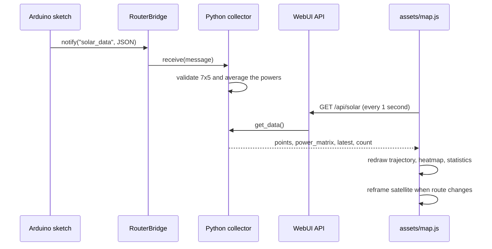

# photoRover · Web dashboard (`assets/`)

This directory contains the browser interface for **photoRover**, a mobile photovoltaic survey prototype built for HACKTURIN 2026 on Arduino UNO Q. The interface is titled **SolarScout** in the current source code. It displays measurements sent by the Arduino sketch and processed by the Python backend, including a colored rover trajectory, a 7 × 5 power heatmap, and an optional satellite background.

The frontend uses **plain HTML, CSS, and JavaScript**. It does not require React, Node.js, or a frontend build step.

## Files

| File | Purpose |
| --- | --- |
| `index.html` | Dashboard markup and inline CSS; responsive layout, statistics, map/image and canvas layers, status messages, legends, and heatmap canvas. |
| `map.js` | Polls the Python API, draws the trajectory and heatmap, updates statistics, resolves a map origin, and requests auto-framed satellite images. |
| `maps-config.js` | **Local configuration file referenced by `index.html`, but not included in the ZIP.** Supplies a Google Maps Static API key to `map.js`; ignored by the repository's `.gitignore`. |

The repository's `app.yaml` enables the Arduino App Lab `arduino:web_ui` brick. `python/app.py` registers the data endpoint consumed by this dashboard.

## Dashboard overview

The interface provides:

- **Current Power:** `latest.power_mw`, the **mean of 35 measured powers** for the most recently received scan.
- **Maximum Power:** the largest **per-position mean** among retained route points. This is *not* the Arduino firmware's single-angle peak reading.
- **Current Position:** the latest relative `x, y` coordinates received from the rover.
- **Measurements:** count of accepted scan positions retained by the Python collector.
- **Solar Trajectory:** a colored line joining successive positions, with numbered markers (numbers displayed when there are at most 50 points). The first marker is blue; the newest is dark.
- **Power Matrix 7×5:** the latest scan's 35 power measurements shown as colored cells. Rows represent pan positions; columns represent tilt positions.
- **Satellite image:** an optional Google Maps Static API image under the transparent trajectory canvas, automatically reframed as the route grows.

The 7 × 5 heatmap has **seven pan-angle rows** (0°, 30°, 60°, 90°, 120°, 150°, 180°) and **five tilt-angle columns** (30°, 60°, 90°, 120°, 150°), matching the current firmware. The canvas itself does **not** label the angles or print numerical power values inside each cell.

## How data reaches the browser



`map.js` uses `fetch("/api/solar", { cache: "no-store" })`. The Python backend exposes that **same-origin** endpoint via `WebUI.expose_api("GET", "/api/solar", collector.get_data)`.

A simplified response looks like:

```json
{
  "points": [
    { "timestamp": "2026-10-11T08:00:00+00:00", "x": 0.0, "y": 0.0, "power_mw": 8.4 },
    { "timestamp": "2026-10-11T08:01:00+00:00", "x": 1.2, "y": 0.5, "power_mw": 14.2 }
  ],
  "power_matrix": [
    [4, 6, 8, 10, 12],
    [5, 7, 9, 11, 13],
    [6, 8, 10, 12, 14],
    [7, 9, 11, 13, 15],
    [8, 10, 12, 14, 16],
    [9, 11, 13, 15, 17],
    [10, 12, 14, 16, 18]
  ],
  "latest": { "timestamp": "2026-10-11T08:01:00+00:00", "x": 1.2, "y": 0.5, "power_mw": 14.2 },
  "count": 2
}
```

The numbers above illustrate the response **shape**, not an actual recorded scan. The real `power_matrix` holds the most recent complete scan; the `points` array retains previous positions and their average powers. The Python collector retains up to **1,500** points in memory per app process.

> **Update frequency:** The browser checks for data every **1,000 ms** (`REFRESH_INTERVAL_MS`). This is not the Arduino's sampling rate: the firmware sends a new message only **after a complete 35-orientation scan**.

## Power colors

Both the trajectory and heatmap call `powerColor()` in `map.js`. The committed settings are:

```javascript
const RED_POWER_MW = 0;
const GREEN_POWER_MW = 20;
```

| Measured power | Display color |
| --- | --- |
| 0 mW or below | Red |
| ~5 mW | Orange |
| ~10 mW | Yellow |
| ~15 mW | Yellow-green |
| 20 mW or above | Green |

Values are clamped at the endpoints. To recalibrate the display for another panel, change these constants in `map.js` and update the labels in `index.html` accordingly. They affect visualization only, not the electrical measurement or Python calculations.

## Run with Arduino App Lab

1. Open the photoRover project in **Arduino App Lab** on the UNO Q.
2. Start its Python application (`python/main.py` calls `start_app()`); the WebUI server is initialized by `python/app.py`.
3. Open the **WebUI URL shown in the App Lab logs** in a browser. The backend commonly uses port `7000`, but use the URL printed by your running instance or the App Lab-provided forwarding URL.
4. Let the rover finish a scan; the statistics and 7×5 heatmap should update. Move the cart and perform further scans to grow the route.
5. For direct API debugging, open **`/api/solar` on the same WebUI origin** and check `count`, `points`, and `power_matrix`.

Do not open `index.html` as a local `file://` page for live operation. Its relative API path must resolve against the running Arduino WebUI backend.

### Enable the satellite background

`map.js` reads its API key from:

```javascript
const GOOGLE_MAPS_KEY = window.SOLARSCOUT_GOOGLE_MAPS_KEY || "";
```

The checked-in `index.html` loads `maps-config.js` **before** `map.js`, but the ZIP **does not contain** `maps-config.js` because it is gitignored. Create `assets/maps-config.js` locally:

```javascript
window.SOLARSCOUT_GOOGLE_MAPS_KEY = "YOUR_RESTRICTED_MAPS_STATIC_API_KEY";
```

In Google Cloud, enable **Maps Static API**, set up billing, and configure application/API restrictions appropriate for the exact URL/origin through which you access App Lab. Google Maps browser-side keys remain visible to clients; excluding this file from Git is not a substitute for key restrictions. Do not commit an unrestricted key.

### Location and automatic zoom

In the archived `map.js`, `MANUAL_LOCATION = null`. The code then tries:

1. Browser geolocation, **only when the browser reports a secure context** and the user grants permission.
2. Approximate IP geolocation via `https://ipapi.co/json/`.
3. A fallback location, **but the current source comments out `FALLBACK_LOCATION`**, so the fallback can fail (see *Known issues*).

Browser/IP location is the **viewer's location estimate**, not an onboard rover GPS position. For a fixed demo origin, configure `MANUAL_LOCATION` with a `lat`, `lon`, and `source` string. The map conversion treats Arduino `x` and `y` as meters in a local coordinate system with **X east and Y north**. The firmware does not reliably guarantee that orientation or GPS-grade position accuracy.

When the set of route points changes, `makeMapFrame()` projects their estimated positions into Web Mercator, calculates a center, and selects a Google Static Maps integer zoom from **0 to 21** to keep the points within approximately **74%** of the image dimensions. A new satellite image is preloaded before its drawing frame is applied. The background uses a **600 × 400 logical-pixel image (`scale=2`)**, overlaid by a **900 × 600 canvas** with the same 3:2 aspect ratio. Google imagery resolution and available detail limit the maximum useful zoom.

The satellite image is **optional**: the line and markers can still be drawn against the dashboard's grid background when an image cannot load.

## Troubleshooting

| Symptom | What to check |
| --- | --- |
| **Connecting...** never changes | Confirm the browser loads `map.js`; open DevTools Console for syntax errors and Network for JS 404s. |
| **Backend disconnected** | Open `/api/solar` on the *same origin*; verify App Lab Python/WebUI is running. |
| **Waiting for samples / 0 measurements** | Wait for a completed Arduino scan; inspect Python logs for `Invalid sensor data` and confirm the firmware sends `"power"` as a 7 × 5 array. |
| **Heatmap blank** | The API must return `power_matrix` with **7 rows of 5 numbers**, not the firmware's `power` key or the legacy 10 × 10 format. |
| **Previous point seems replaced** | Check API `count`, X/Y values, and whether multiple readings overlap spatially. The numbered markers are redrawn from all stored `points`. |
| **No satellite image** | Confirm `maps-config.js` exists, loads before `map.js`, and sets `window.SOLARSCOUT_GOOGLE_MAPS_KEY`. Inspect DevTools **Network → staticmap** for HTTP 400/403 and its response. |
| **Location unavailable** | Local HTTP may block precise browser geolocation; IP lookup can also fail. Supply an explicit map origin or handle the missing-location case. |
| **Satellite route appears misplaced** | Relative IMU X/Y is not GPS, and the code assumes an east/north alignment that is not established by the firmware. |

## Known issues in the supplied ZIP

- **Missing fallback declaration:** `map.js` ends `getMapLocation()` with `return FALLBACK_LOCATION;`, but the `FALLBACK_LOCATION` declaration is commented out. If browser and IP geolocation fail, this produces a `ReferenceError`; location initialization can stop. Fix by defining a fallback explicitly, or returning `null` and handling that case before accessing `mapOrigin.lat`.
- **Missing local config file:** `index.html` references `maps-config.js`, but it is absent from the committed archive by design. Without creating the file locally, the satellite background will not have an API key.
- **Approximate cart position:** The trajectory is an IMU-derived estimate, and placing it over a geographic satellite map should not be interpreted as accurate GPS mapping.
- **No per-angle labels or per-cell numbers:** The 7 × 5 heatmap currently uses plain colored canvas cells, with no pan/tilt axis labels or peak-cell marker.

## Related documentation

- [photoRover project overview](../README.md)
- [Python backend and data API](../python/README.md)
- [Arduino firmware and scan geometry](../sketch/README.md)
