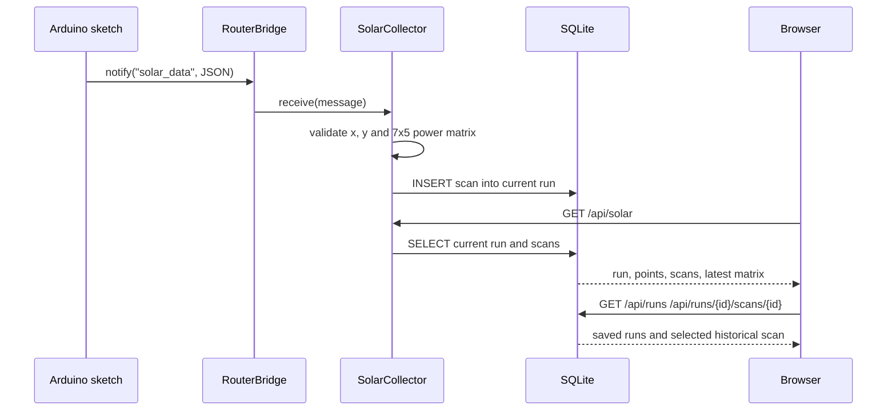

# photoRover: Python backend, SQLite storage and REST API

This folder implements photoRover's **Arduino UNO Q Python side**. It receives each complete solar scan from the MCU, validates the power matrix, persists it in SQLite, and exposes live and historical data to the browser through Arduino App Lab's WebUI.

The implementation in this repository is **database-backed**: the former in-memory-only run history is no longer the source of truth.

## Files

| File | Responsibility |
| --- | --- |
| `main.py` | Entry point: imports and calls `app.start_app()`. |
| `app.py` | Sets up `PhotoRoverDB`, `SolarCollector`, Arduino `Bridge.provide` and WebUI REST endpoints; includes a disabled `TEST_MODE`. |
| `collector.py` | Receives `solar_data` messages, validates X/Y and the matrix, creates the current run, and inserts completed scans into SQLite. Uses a lock around active-run changes and scan insertion. |
| `processing.py` | Checks 7 rows × 5 finite numeric values and calculates their arithmetic mean. |
| `db.py` | Initializes SQLite; implements creating/listing/fetching/renaming/deleting runs, updating starting GPS, inserting scans, and loading history. |
| `requirements.txt` | Historical general-purpose dependencies. The current API does not import NumPy, Pandas, Plotly, Streamlit or Folium; App Lab supplies its own backend integration. |
| `generate_test_data.py`, `test_data.json` | **Legacy/incompatible** generator and fixture (10×10 voltage/current arrays instead of 7×5 `power`). |
| `solar_data.csv` | Bundled sample artifact. The database implementation does **not** append new scans to it. |

## Runtime data flow



At Python startup, `SolarCollector(db)` calls `db.create_run()` **unconditionally**: each application session gets a fresh live run. Old runs remain in SQLite. A dashboard **New run** button also calls `collector.start_new_run()`; all *subsequent* Bridge scans are directed to the newly active run. Incoming records are time-stamped by Python when they are received, not by an RTC in the Arduino payload.

### MCU input contract

`Bridge.notify("solar_data", json)` sends a JSON string with:

```json
{
  "x": 1.25,
  "y": -0.40,
  "power": [
    [2,4,6,8,10],
    [3,5,7,9,11],
    [4,6,8,10,12],
    [5,7,9,11,13],
    [6,8,10,12,14],
    [7,9,11,13,15],
    [8,10,12,14,16]
  ]
}
```

- `x`, `y` are finite relative-position estimates, treated as **meters** by the UI. The MCU does **not** transmit absolute latitude/longitude.
- `power` is a **pan-major** matrix: `power[panIndex][tiltIndex]` (7 × 5, values in **mW**).
- `processing.process_power_matrix()` converts each entry to a float, rejects nonfinite numbers, and computes `mean = sum(35 values) / 35`.
- `collector.receive()` stores the matrix, UTC receive timestamp, X/Y and rounded average (3 decimal places). `db.add_scan()` also stores the maximum of all 35 values.
- Invalid payloads and SQLite failures are logged and skipped. The collector does not reconstruct missing scans or collect GPS from the MCU.

## SQLite database

### File location and initialization

`PhotoRoverDB()` creates missing directories and a database file on first use; `CREATE TABLE IF NOT EXISTS` makes startup safe with an existing database.

Default path:

```text
~/.photorover/photorover.sqlite3
```

Override before starting App Lab with the environment variable `PHOTOROVER_DB_PATH` set to an **absolute, writable, persistent** location. The actual resolved path is printed on startup:

```text
photoRover database: /.../.photorover/photorover.sqlite3
```

SQLite is in Python's standard library (`sqlite3`). No separately running SQLite server is required. The module enables foreign keys, a busy timeout and **WAL journal mode**. It opens short-lived connections and closes them after operations. While the database is in use, the directory may also contain SQLite `-wal` and `-shm` sidecar files; avoid copying only the database file mid-write. Prefer a proper SQLite backup or stop the app before copying database files.

### Schema

The current code creates **two tables**:

```sql
CREATE TABLE IF NOT EXISTS runs (
    id INTEGER PRIMARY KEY AUTOINCREMENT,
    name TEXT NOT NULL,
    started_at TEXT NOT NULL,
    start_latitude REAL,
    start_longitude REAL,
    location_source TEXT
);

CREATE TABLE IF NOT EXISTS scans (
    id INTEGER PRIMARY KEY AUTOINCREMENT,
    run_id INTEGER NOT NULL REFERENCES runs(id) ON DELETE CASCADE,
    measured_at TEXT NOT NULL,
    x REAL NOT NULL,
    y REAL NOT NULL,
    average_power_mw REAL NOT NULL,
    max_power_mw REAL NOT NULL,
    power_matrix_json TEXT NOT NULL
);
```

There is also an index on `(run_id, id)` in `scans`. Every row in `scans` represents **one completed 35-reading sweep**, not one angular reading. The 35 values are preserved inside `power_matrix_json` as a pan-major 7×5 JSON array. SQLite does not currently store each individual angle as a separate normalized row.

**Runs** hold their start time in ISO-8601 UTC (`started_at`), plus an optional rover start location. **Scans** hold per-scan receive timestamp (`measured_at`), MCU relative X/Y, scan-mean power and angular-peak power. Missing run GPS is represented by `NULL`; nothing silently inserts browser/IP fallback coordinates in the database.

### Run operations

- `create_run(name=None)`: creates a run with the provided nonblank name or an automatic name such as `Survey 2026-10-11T10:00:00+00:00`.
- `list_runs()`: newest-first list including `scan_count` and `last_scan_at`.
- `rename_run(id, name)`: nonempty names, up to 100 characters.
- `set_origin(id, lat, lon, source)`: starting latitude in **−85..85**, longitude in **−180..180** and a source such as `manual` or `browser`.
- `add_scan(run_id, point, matrix)`: verifies finite X/Y and 35 finite values, then inserts one scan atomically.
- `run_data(id)`: returns run metadata, all point/scan summaries, latest point and latest full matrix.
- `get_scan(run_id, scan_id)`: retrieves a *specific* scan including its full 7×5 matrix.
- `delete_run(id)`: cascades deletion to all related scans; removing the **active** run causes `SolarCollector` to create a replacement live run.

## HTTP API

WebUI registers these **same-origin** routes in `app.py` before `App.run()`:

| Method | Route | Meaning |
| --- | --- | --- |
| `GET` | `/api/solar` | Full **active** run, including current route, scan summaries and latest matrix. |
| `GET` | `/api/runs` | Run summaries with `active_run_id`. |
| `POST` | `/api/runs` | Create and activate a new run, optional JSON `{"name":"…"}`. |
| `GET` | `/api/runs/{run_id}` | All stored summary data for that run and its most recent matrix. |
| `PATCH` | `/api/runs/{run_id}` | Rename with JSON `{"name":"North parking lot"}`. |
| `PATCH` | `/api/runs/{run_id}/origin` | Save start GPS with `{"latitude":45.47,"longitude":9.22,"source":"manual"}`. |
| `DELETE` | `/api/runs/{run_id}` | Permanently delete that run plus its scans. |
| `GET` | `/api/runs/{run_id}/scans/{scan_id}` | Full individual scan including 7×5 matrix. |

Missing runs/scans return HTTP **404**; invalid names and invalid coordinates produce HTTP **400** where handled. Request bodies for POST/PATCH are validated by Pydantic (malformed or missing fields may produce **422**).

### Typical responses

`GET /api/runs`:

```json
{
  "active_run_id": 3,
  "runs": [
    {
      "id": 3,
      "name": "Campus north",
      "started_at": "2026-10-11T10:00:00+00:00",
      "start_latitude": null,
      "start_longitude": null,
      "location_source": null,
      "scan_count": 2,
      "last_scan_at": "2026-10-11T10:02:00+00:00"
    }
  ]
}
```

`GET /api/solar` or `GET /api/runs/3`:

```json
{
  "run": {"id":3, "name":"Campus north", "started_at":"2026-10-11T10:00:00+00:00", "start_latitude":null, "start_longitude":null, "location_source":null},
  "run_id": 3,
  "points": [{"id":12, "timestamp":"2026-10-11T10:02:00+00:00", "x":1.2, "y":-0.4, "power_mw":5.2, "max_power_mw":12.0}],
  "scans": [{"id":12, "run_id":3, "measured_at":"2026-10-11T10:02:00+00:00", "x":1.2, "y":-0.4, "average_power_mw":5.2, "max_power_mw":12.0}],
  "power_matrix": [[12,5,5,5,5],[5,5,5,5,5],[5,5,5,5,5],[5,5,5,5,5],[5,5,5,5,5],[5,5,5,5,5],[5,5,5,5,5]],
  "latest": {"id":12, "timestamp":"2026-10-11T10:02:00+00:00", "x":1.2, "y":-0.4, "power_mw":5.2, "max_power_mw":12.0},
  "count": 1
}
```

The sample `power_matrix` has 35 numbers, with a 12 mW peak and a 5.2 mW mean. Real responses return a 7×5 numeric array, or `[]` if the run has no scans. For a selected historic cell grid, retrieve `/api/runs/{run_id}/scans/{scan_id}` instead of assuming the latest matrix is the one selected.

### Manual API example

From the machine/browser origin serving the WebUI, use a command such as:

```bash
curl http://localhost:7000/api/runs
curl -X POST http://localhost:7000/api/runs \
  -H 'Content-Type: application/json' \
  -d '{"name":"Parking lot"}'
```

`localhost:7000` is **illustrative**: replace it with the host/port actually provided by Arduino App Lab. For the browser dashboard, relative paths resolve automatically.

## Operational notes and limitations

- **No authenticated API:** anyone with WebUI network access can create, rename or delete data. Keep the app on a trusted network and add authentication before Internet exposure.
- **Stored origin is metadata:** the `start_latitude`/`start_longitude` fields are entered manually or via browser and are *not* MCU GPS. The database does **not** currently normalize `x/y` to the first scan of a newly created run; creating a run during continuous MCU operation keeps the current IMU coordinate frame.
- **CSV is not current storage:** `solar_data.csv` is present in the repository but the current collector writes to SQLite instead.
- **Legacy test fixture cannot be enabled unchanged:** `TEST_MODE = False` in `app.py`. Turning it on with the bundled fixture sends `voltage`/`current` keys rather than `power`, and those scans are rejected. Fix the fixture or generator first.
- **Performance:** current routes return all scan summaries/points for a run. There is no pagination or retention limit at the database layer yet. For very long surveys, add pagination or downsampling.
- **Backups:** export/backup the persistent SQLite file before device resets or application replacement. Deleting a run cascades and is not undoable through the UI.

See [project overview](../README.md), [firmware](../sketch/readme.md), and [dashboard](../assets/readme.md).
