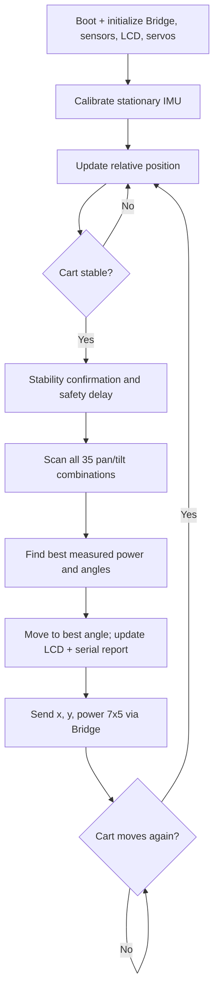

# photoRover · Arduino firmware

`sketch.ino` is the microcontroller firmware for **photoRover**, a mobile, two-axis photovoltaic scanning prototype built for HACKTURIN 2026 on the **Arduino UNO Q**. It measures a photovoltaic panel at multiple orientations, estimates relative cart movement using a Modulino Movement IMU, shows the strongest scan result on a 16×2 LCD, and sends a **7×5 power matrix** to the Python backend through RouterBridge.

## Hardware interfaces in the code

| Device | Interface / definition | Role |
| --- | --- | --- |
| Pan servo | `panServo.attach(9)` | Horizontal rotation, commanded between 0° and 180° |
| Tilt servo | `tiltServo.attach(10)` | Panel inclination, commanded between 30° and 150° |
| INA219 | I²C / `Adafruit_INA219 ina219(0x40)` | Bus voltage and current measurement |
| Analog light sensor | `analogRead(A0)` | Supplemental light value at every scan orientation |
| Modulino Movement | `Modulino.begin()`, `movement.begin()` | Acceleration, roll and pitch, stability sensing |
| Grove RGB LCD | `rgb_lcd lcd; lcd.begin(16, 2)` | Shows last relative position and peak measured power |
| Serial | `Serial.begin(9600)` | Scan details, differences, status, and CSV-formatted text |
| Arduino RouterBridge | `Bridge.begin()`, `Bridge.notify()` | Transfers completed scans to Python App Lab |

**Wiring caveat:** These are **connections inferred from source code**, not a complete verified electrical schematic. The sketch does not specify supply voltages, a power-distribution circuit, or the detailed Modulino connector routing. Power the servos from an appropriately rated regulated supply and share ground with the controller as required by the hardware design.

### Libraries and platform

The sketch includes:

```cpp
#include "Modulino.h"
#include <Servo.h>
#include <Adafruit_INA219.h>
#include <Wire.h>
#include <Arduino_RouterBridge.h>
#include "rgb_lcd.h"
```

`sketch.yaml` declares the `arduino:zephyr` platform and pins versions for **Arduino_Modulino**, **Servo**, **Adafruit INA219**, **Grove - LCD RGB Backlight**, and other dependencies. Its `fqbn` field is currently blank; select/build for the correct Arduino UNO Q target in your App Lab environment.

## Scanning geometry

The panel's pan and tilt motion is defined by:

```cpp
const int PAN_MIN  = 0;
const int PAN_MAX  = 180;
const int TILT_MIN = 30;
const int TILT_MAX = 150;
const int STEP     = 30;
```

| Axis | Scan angles | Positions |
| --- | --- | --- |
| Pan | 0°, 30°, 60°, 90°, 120°, 150°, 180° | 7 |
| Tilt | 30°, 60°, 90°, 120°, 150° | 5 |
| Total | Pan × tilt | **35 measurements per stationary scan** |

The arrays are declared with `[PAN_STEPS][TILT_STEPS]`, so `powerMap[panIndex][tiltIndex]` has **7 rows and 5 columns**.

A complete scan runs pan as the outer loop and tilt as the inner loop. It also collects `lightMap`, `voltageMap`, and `currentMap` locally, but **only `powerMap`** is transmitted to Python.

## Electrical measurements

For each orientation, `readPanel()` performs five INA219 samples with a 10 ms delay between samples. It averages:

- `ina219.getBusVoltage_V()` → voltage in volts.
- `ina219.getCurrent_mA()` → current in milliamperes.

Then computes:

```cpp
power_mW = avgV * avgI;
```

This yields **milliwatts** because `V × mA = mW`. `readLight()` independently averages five ADC values on A0.

The maximum power in the sweep is found by:

```cpp
if (panel.power_mW > maxPower) {
    maxPower = panel.power_mW;
    bestPan = pan;
    bestTilt = tilt;
}
```

After scanning, the panel is returned to `bestPan` and `bestTilt`, and the LCD is updated with `Pmax` and the estimated rover X/Y position.

> **Interpretation:** This is measured electrical output under the test circuit and load conditions, **not calibrated irradiance**. Changes to the load, battery/charger arrangement, panel temperature, and measurement wiring can change observed power.

## Scan and movement state machine



Key functions in `sketch.ino`:

| Function | Responsibility |
| --- | --- |
| `setup()` | Initialize Serial, RouterBridge, I²C, LCD, INA219, Modulino and servos; calibrate IMU |
| `calibrateIMU()` | Average stationary accelerometer X/Y readings to establish offsets |
| `updatePosition()` | Integrate offset-corrected acceleration into approximate X/Y velocity and position |
| `isStable()` / `waitForStability()` | Wait until acceleration readings are sufficiently stable and confirm a safety delay |
| `readPanel()` / `readLight()` | Sample electrical readings and analog light level |
| `Scan()` | Fill the 7×5 measurement maps and identify maximum-power pan/tilt |
| `savePreviousMap()` / `printDiffMap()` | Compare power against the previous full scan |
| `recordMapPoint()` / `printMapCSV()` | Retain and print a bounded history of scan locations and best orientations |
| `showScanResultLCD()` | Show the most recent scan result on the 16×2 display |
| `sendPositionAndPower()` | Build JSON and call `Bridge.notify("solar_data", json)` |

### Timing

The sketch settles servos for **350 ms per command** and averages both light and electrical samples at every one of the **35** orientations. The pan servo is additionally moved once per pan row. Consequently, a complete scan typically takes **tens of seconds**, plus stability checks and serial output. The web UI's one-second refresh rate does **not** imply one new scan per second.

The program sends one Bridge message **after** the entire scan, not one message per angle.

## Arduino → Python message format

`sendPositionAndPower()` serializes:

```json
{
  "x": 1.25,
  "y": -0.40,
  "power": [
    [2, 4, 6, 8, 10],
    [3, 5, 7, 9, 11],
    [4, 6, 8, 10, 12],
    [5, 7, 9, 11, 13],
    [6, 8, 10, 12, 14],
    [7, 9, 11, 13, 15],
    [8, 10, 12, 14, 16]
  ]
}
```

The actual sketch formats X/Y to **three decimal places** and each power value to **one decimal place**. This example shows the shape and units, not a real sensor recording.

The notification call is:

```cpp
Bridge.notify("solar_data", json);
```

The matching Python receiver is registered in `python/app.py` under `"solar_data"`, and `python/collector.py` reads `data["power"]`. Python validates the 7×5 array, computes its **mean** power and exposes the result at `GET /api/solar`.

### Peak power vs. mean power

- **MCU:** keeps `maxPower` (best individual orientation) to select servo angles and show `Pmax` on the LCD.
- **Python:** averages **all 35** values to compute each trajectory-point `power_mw`.
- **Web dashboard:** colors the route by that **average** and displays the latest full matrix.

Thus the LCD maximum and web trajectory power are different statistics by design.

## How to run a measurement session

1. Connect the hardware and ensure the INA219 is found on I²C address `0x40`.
2. Open the project in **Arduino App Lab** and build/upload the sketch for the UNO Q using the libraries/profile in `sketch.yaml`.
3. Start the companion Python App Lab application (`python/main.py`); verify the `solar_data` Bridge receiver is registered.
4. Open the Serial Monitor at **9,600 baud**. The sketch prints initialization status and IMU calibration results.
5. Keep the cart **stationary during calibration**.
6. Leave it stationary for the stability check and complete 35-point servo scan. Observe electrical readings and the reported optimal angle.
7. Wait for `JSON inviato:` in Serial and for the Python collector to print `X=..., Y=..., P=... mW`.
8. Move the cart, stop at a new location, then allow another scan to build the route.

The firmware waits for movement after every scan before beginning the next one.

## Engineering limitations and notes

- **IMU dead reckoning drifts.** `updatePosition()` integrates acceleration over elapsed time but does not compensate for orientation/tilt and accumulated sensor bias. X/Y are local estimates, not GPS coordinates, and their axes are not guaranteed east/north.
- **Scan-time integration gap.** Long servo scans interrupt calls to `updatePosition()`; the first subsequent time interval may be large. This can introduce position error if the acceleration estimate is nonzero.
- **Stability is based on acceleration differences.** The cart may be judged stable if acceleration is constant, even when physical motion is not zero. This is a prototype heuristic, not a motion-tracking guarantee.
- **Serial map history is limited to 50 points** (`MAX_POINTS = 50`); Python keeps a separate in-memory history of up to 1,500 points.
- **Negative measured power is possible** for certain current directions; `maxPower` starts at zero, so if every reading is negative the default best angles (90°, 90°) remain selected.
- **Servo safety:** check mechanical clearances, stops, and power-supply current capacity before scanning the full configured angle range.
- **Calibration and load matter:** INA219 reports electrical measurements at its connection point; ensure the wiring and test load match the quantity you intend to characterize.

## Related documentation

- [Project overview](../README.md)
- [Python data processing and WebUI API](../python/README.md)
